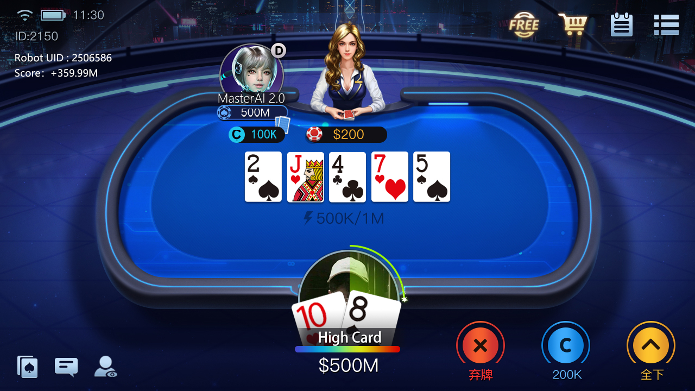
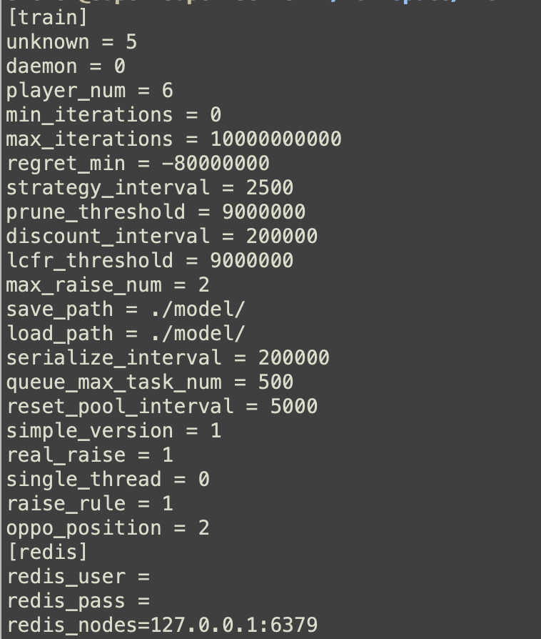

# Deep Hold'em AI：德州扑克 AI 研究源码

> 面向单挑无限注德州扑克（HUNL）的研究型代码库，涵盖 CFR 子博弈求解、ReBeL 风格递归求解、反事实价值网络、自博弈训练、监督策略学习与 C++ 蒙特卡洛模拟。

[繁體中文](README.zh-TW.md) · [English](README.en.md) · [项目网站](https://deeptexas-ai.github.io/deep-holdem-ai/) · [简体页面](https://deeptexas-ai.github.io/deep-holdem-ai/zh-cn/)



## 项目定位

Deep Hold'em AI 是一套用于扑克人工智能、博弈论与不完全信息游戏实验的研究源码。公开代码包含 HUNL 规则与状态树、CFR 子博弈求解器、递归求解流程、价值网络、自博弈数据生成、经验回放、监督策略网络以及 C++ 蒙特卡洛组件。

本项目适合算法研究、离线训练、策略评估和教学复现，不是线上牌局实时辅助工具，也不提供任何平台的识别、自动操作或规避检测能力。

## 已由源码验证的核心能力

| 模块 | 能力 | 源码位置 |
| --- | --- | --- |
| HUNL 游戏引擎 | 52 张牌、四个下注轮次、fold / check-call / 多档 raise / all-in、终局收益与牌型评估 | `game/texas_holdem/` |
| CFR 子博弈求解 | 遗憾更新、平均策略、最佳响应、可利用度、EV 与到达概率计算 | `game/subgame_solving.py` |
| 递归求解 | 从公共状态构造子博弈，传播双方手牌信念并在后续状态继续求解 | `game/recursive_solving.py` |
| ReBeL 风格接口 | 加载价值网络，在当前公共状态与信念上计算根节点策略 | `robot/rebel/` |
| 自博弈训练 | 多进程数据生成、价值/策略损失、模型同步、回放缓冲与验证集 | `cfv/selfplay.py`, `rela/` |
| 监督策略学习 | 从已求解状态构造数据集并训练 `StrategyNet` | `supervised_strategy/` |
| 蒙特卡洛与手牌工具 | C++ 模拟器、Python 牌型函数与绑定基础设施 | `csrc/mc/`, `robot/gto_mc/` |
| 配置化实验 | 盲注、筹码、加注比例、迭代次数、树深、网络设备和训练规模 | `conf/` |

## HUNL 玩法模型

引擎围绕两人无限注德州扑克建模：小盲和大盲建立初始底池，牌局依次经过翻牌前、翻牌、转牌和河牌。每个决策点根据公共牌、双方累计下注、当前行动者、可行行动和加注次数建立公共状态。默认动作抽象包含弃牌、过牌/跟注、多个底池比例加注和全押，便于在可控树规模下进行算法实验。

## 算法流程

1. `Game` 生成初始公共状态、可行行动与后继状态。
2. `Tree` 从根状态展开子博弈，并标记终局与叶节点。
3. CFR 迭代更新即时遗憾和平均策略；叶节点可由价值网络估计。
4. 递归求解器依据已选行动更新双方私牌信念，再进入下一公共状态。
5. 自博弈进程产生训练样本，经验回放向价值/策略网络提供批次。
6. 评估工具计算期望收益、最佳响应和可利用度等研究指标。

## 训练配置实景

下图来自仓库原有素材，展示可配置的训练迭代、遗憾参数、剪枝、模型路径和 Redis 连接信息。它是训练配置/终端画面，不是线上牌局识别界面。



## 牌桌演示素材

仓库原有牌桌图展示了机器人席位与德州牌桌呈现。图片仅用于说明项目历史演示形态，不代表对第三方平台的集成或自动操作能力。

<p align="center">
  
  
</p>

## 目录结构

```text
cfv/                  反事实价值模型、自博弈与训练任务
conf/                 HUNL、ReBeL、监督学习和实验配置
csrc/                 C++ 蒙特卡洛模拟器及 Python 绑定依赖
game/                 游戏状态、树、CFR 与递归子博弈求解
rela/                 回放缓冲、数据循环与运行上下文
robot/rebel/          ReBeL 风格策略求解入口
robot/gto_mc/         扑克牌型与蒙特卡洛相关工具
supervised_strategy/  策略数据集与监督网络
tests/                规则和算法测试
```

## 适合的使用场景

- HUNL、CFR、递归求解和不完全信息博弈研究
- 反事实价值网络与自博弈训练实验
- 策略网络、经验回放和离线机器人评测
- 扑克规则、状态树、EV 与可利用度教学
- C++ / Python 混合计算组件的二次研究

## 运行前说明

仓库包含历史组件、C++ 扩展、模型路径与分布式训练配置。请先查看 `conf/`、构建脚本和测试，再根据本机的 Python、PyTorch、CMake、编译器与可选 Redis 环境调整参数。仓库不应被宣传为“下载 EXE 即可运行”，公开树中也没有足够证据支持该承诺。

## 负责任使用

本项目仅用于合法的研究、教育、离线训练与基准测试。请勿用于未经允许的线上实时决策、自动操作、绕过平台规则或任何损害公平性的行为。使用者需自行遵守所在地法律、比赛规则和第三方服务条款。

## 联系方式

- Telegram：[xuzongbin001](https://t.me/xuzongbin001)
- Email：[masterai918@gmail.com](mailto:masterai918@gmail.com)
- GitHub：[deeptexas-ai/deep-holdem-ai](https://github.com/deeptexas-ai/deep-holdem-ai)

## 关键词

德州 AI 源码、德州扑克 AI、HUNL、CFR 算法、ReBeL、递归求解、自博弈、反事实价值、扑克机器人、博弈论、Texas Hold'em AI source code、poker AI research。

